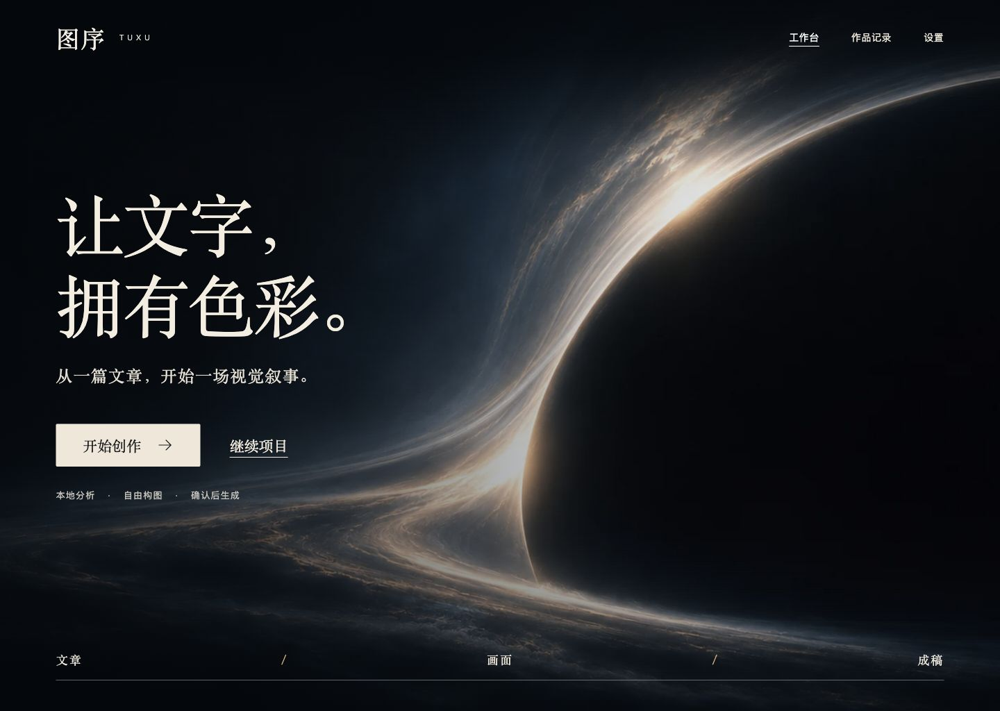
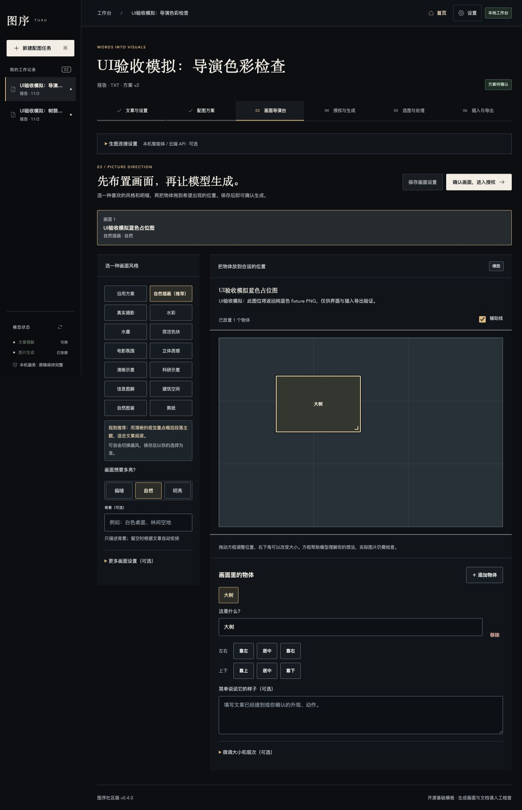
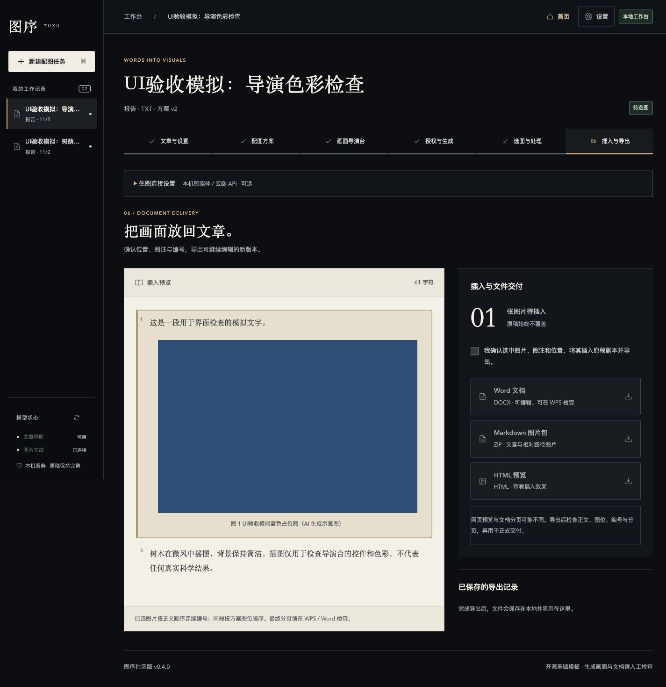

# 图序社区版 v0.4.0 · 让文字，拥有色彩。

本次更新带来电影式入口与统一工作台，保留先分析、再审阅、确认后生成的流程。

- **八套动态首页**：黑洞、折光、星际、城市、田野、高山、大海、DNA双螺旋；原生Seedance2.0背景，先降噪再生成720p视频，每次进入随机取用，当前页面不轮播。
- **统一UI/UX**：文章导入、配图方案、简明导演台、授权生成、选图处理、插入导出，以及设置和历史。十四种画风及语义推荐、明暗与主体摆放保持可用。
- **更可靠的进度与草稿保护**：未保存修改得到保护，重新分析需确认；旧导出记录、只有授权或结果未知不会冒充当前生成完成。零图方案标明无需生图。
- **可访问动效**：尊重系统减少动态效果，可手动关闭；视频出错时显示底图。
- **截图**：仓库README及[完整截图页](https://github.com/zcxpub-cmd/tuxu-community/blob/v0.4.0/docs/screenshots.md)包含八套首页和六个关键页面。工作台截图为标注的模拟数据，用于界面说明，蓝色图不是模型效果示例。

## 部署

Python3.12+、Node.js22.18+、Ollama；支持macOS/Linux，Windows通过WSL。默认Qwen2.5-VL Q4_K_M量化包约6GB。仅文章分析与提示词的参考起点为M1/16GB或相近CPU/16GB、SSD预留15GB，建议24GB以上；该配置不是本地扩散生图预算或延迟保证。生图需自备具备工具能力的本机智能体、图像API或本地ComfyUI。运行./setup.sh后./start.sh。

[模型与硬件说明](https://github.com/zcxpub-cmd/tuxu-community/blob/v0.4.0/docs/text-model-hardware.md) · [安装说明](https://github.com/zcxpub-cmd/tuxu-community/blob/v0.4.0/docs/installation.md)

完整提示词仍在后台，文章分析和提示词继续使用本地模型。源码及发行包不包含API密钥、账号、私人稿件、运行数据或模型权重；模型提供官方链接。生成插图保留编号图注中的“（AI 生成示意图）”，不追加重复独立声明。

本版继续作为社区预览版。八背景视频已实际生成并逐一网页实播；六步界面使用隔离模拟数据和真实文档引擎验证，不代表任意文章、模型或智能体的图像质量承诺。发布检查覆盖媒体/截图白名单与凭据模式，原稿不覆盖。
