# 图序界面截图

以下为实际网页截图。首页背景视频另见仓库frontend/public/visuals；截图本身为静态JPEG。六个工作台页面使用明确标注的隔离模拟数据，蓝色图不是生图质量示例。

## 八套完整首页

### 黑洞

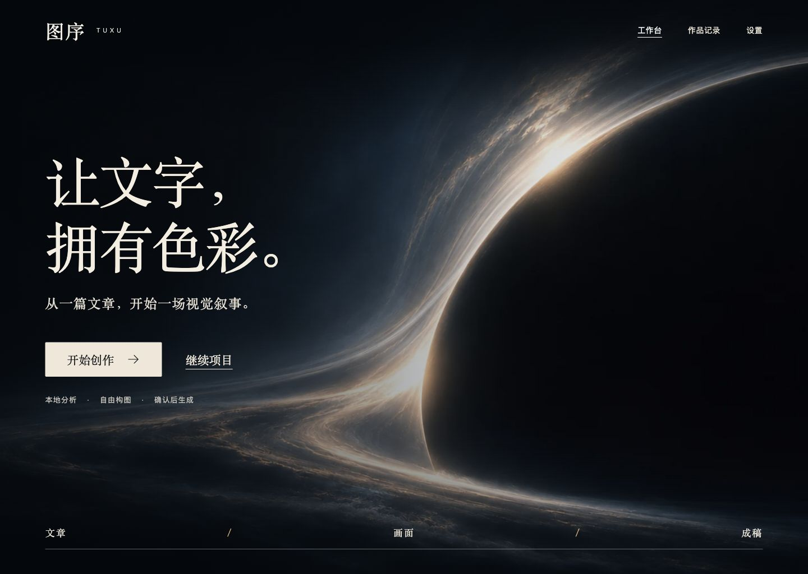

### 折光

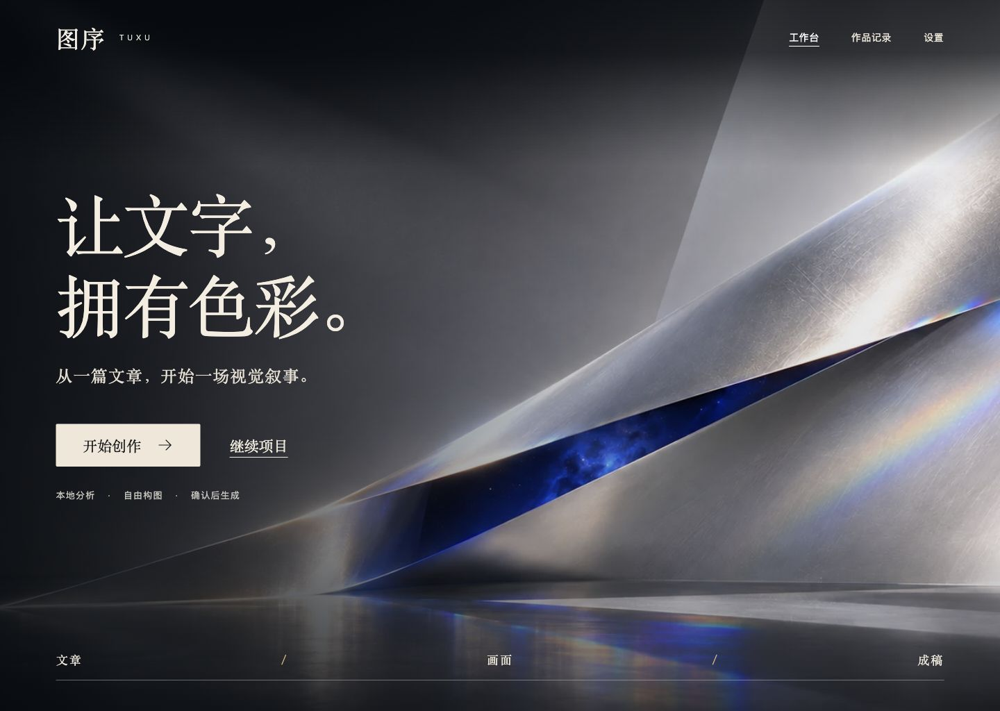

### 星际

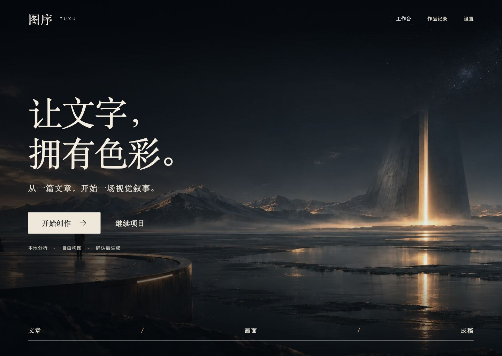

### 城市

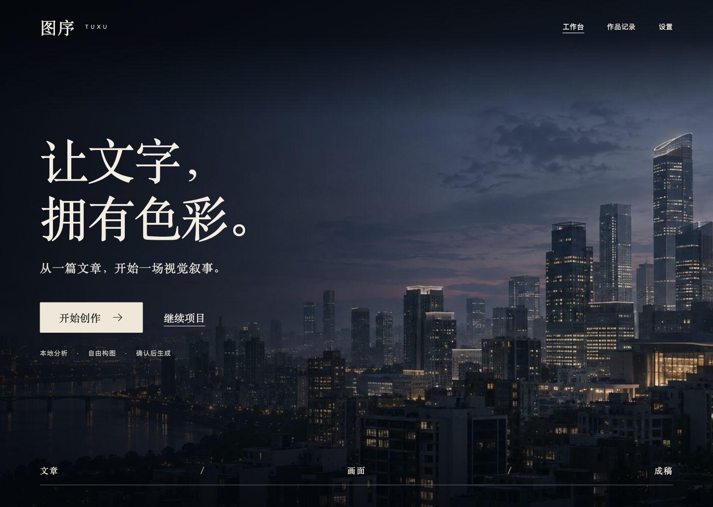

### 田野

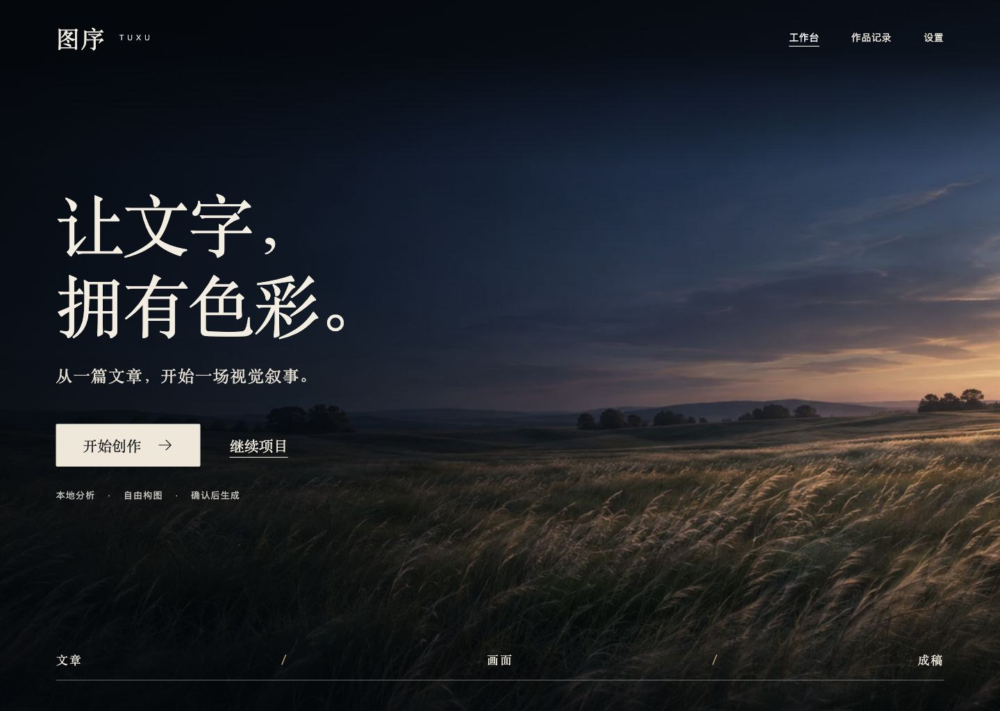

### 高山

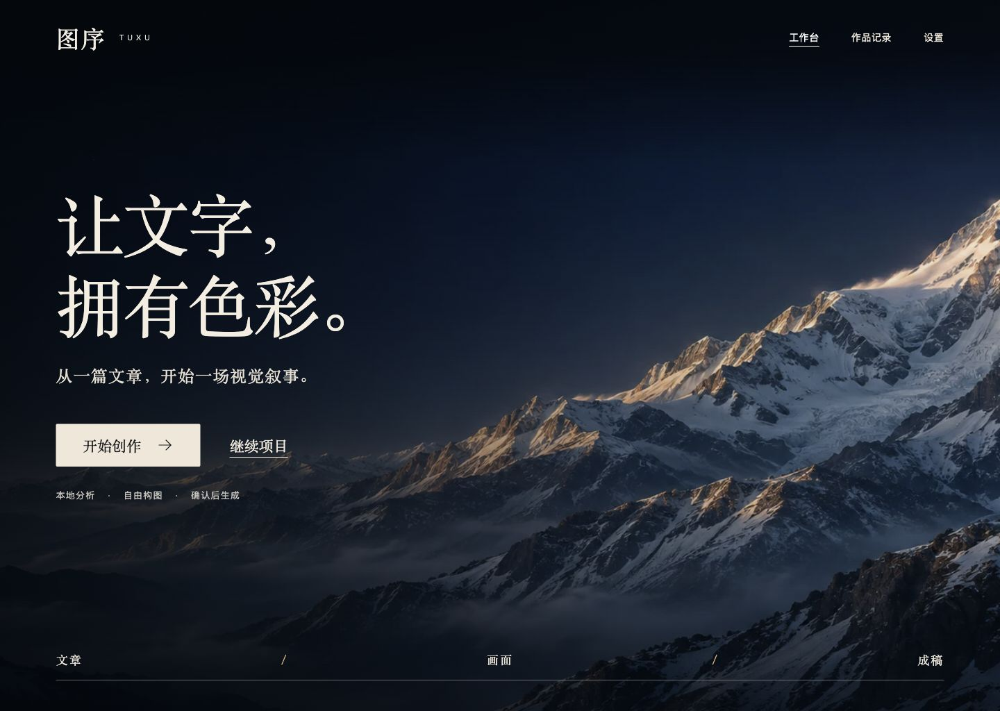

### 大海

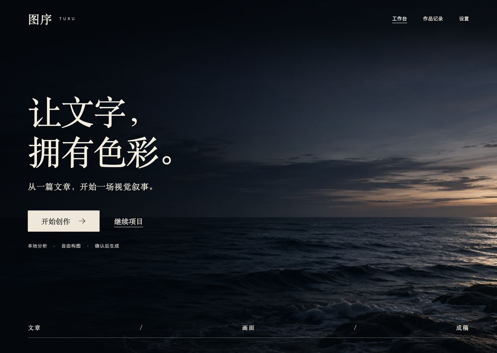

### DNA双螺旋

## 六个关键页面

### 文章与设置

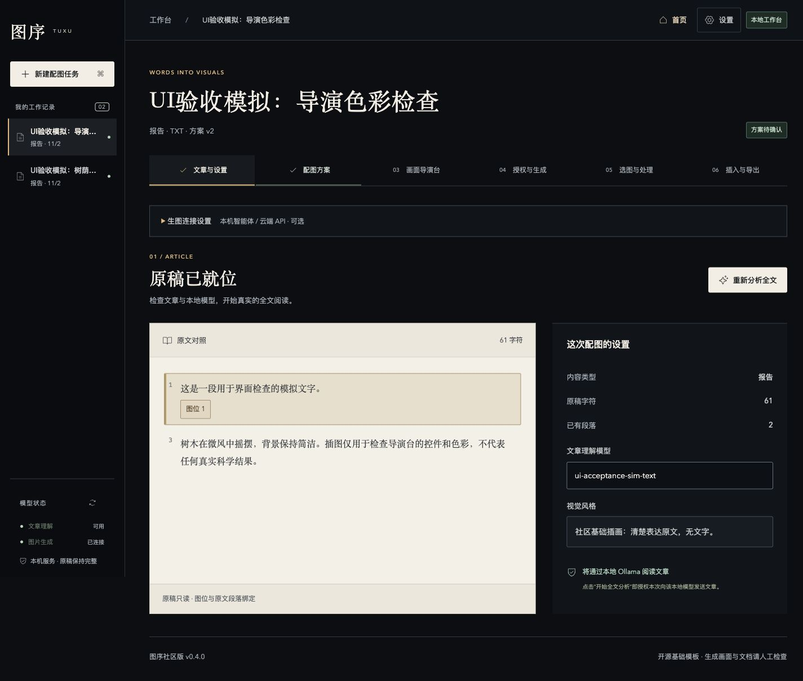

### 配图方案

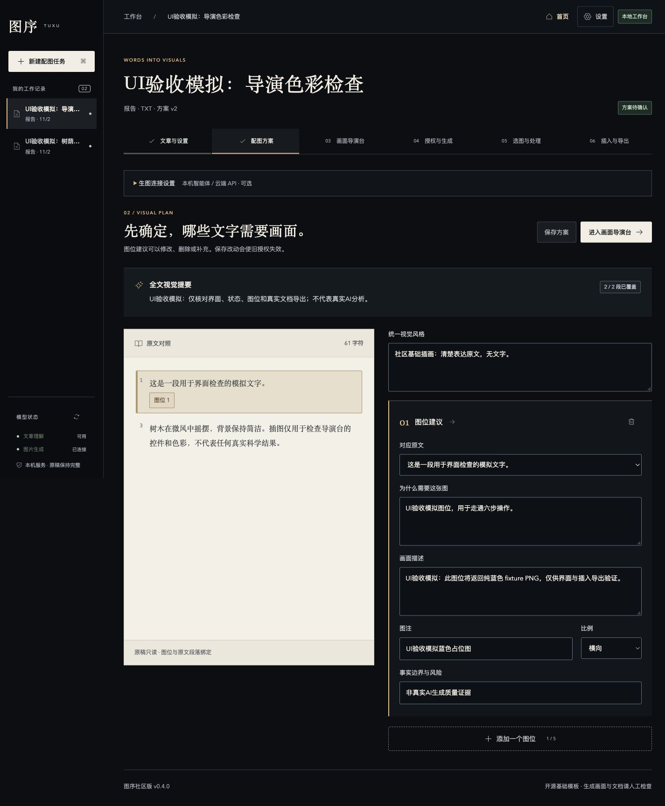

### 简明导演台

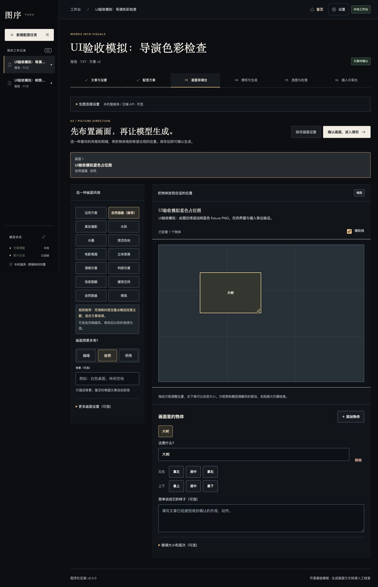

### 授权与生成

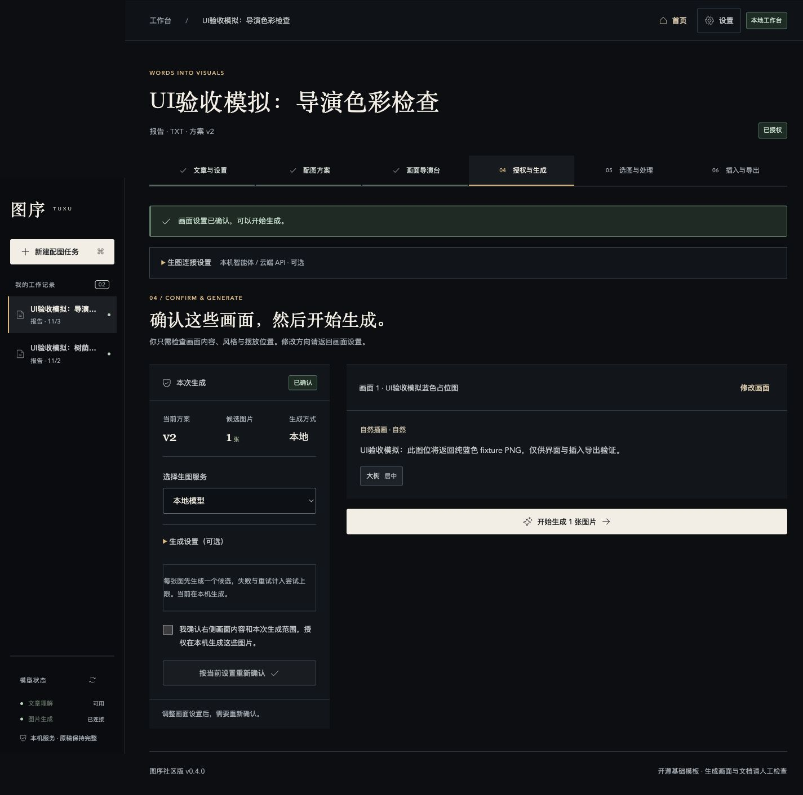

### 选图与处理

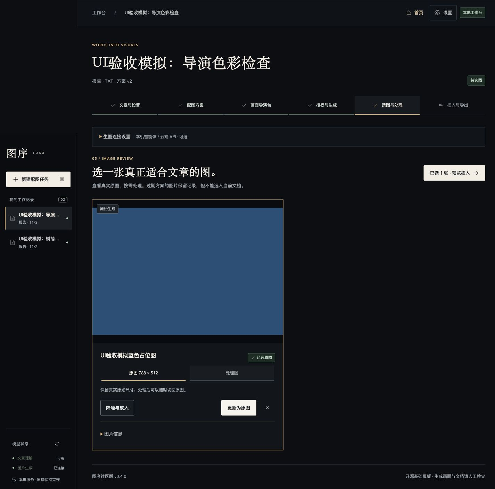

### 插入与导出

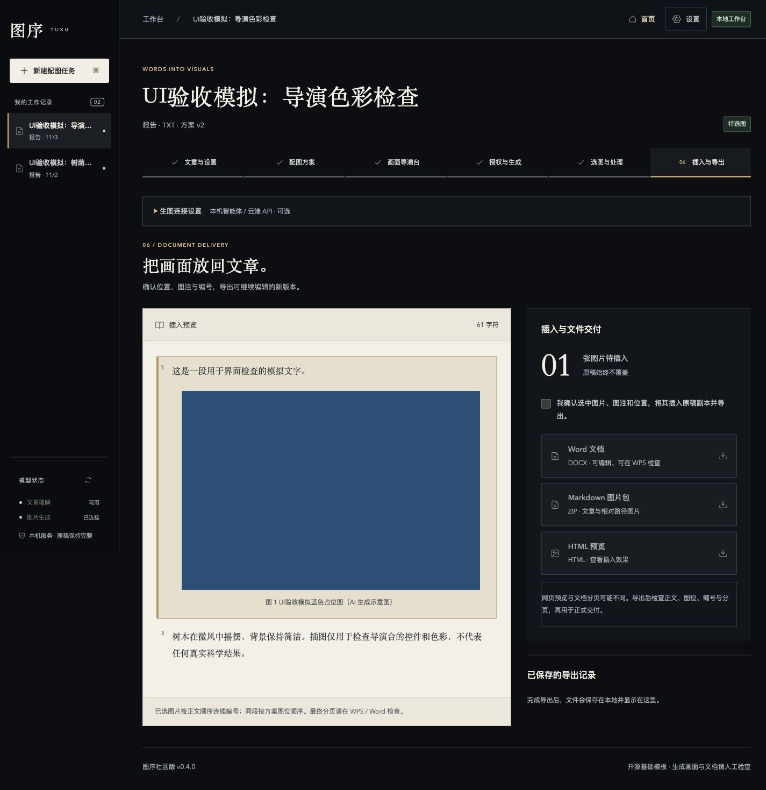
